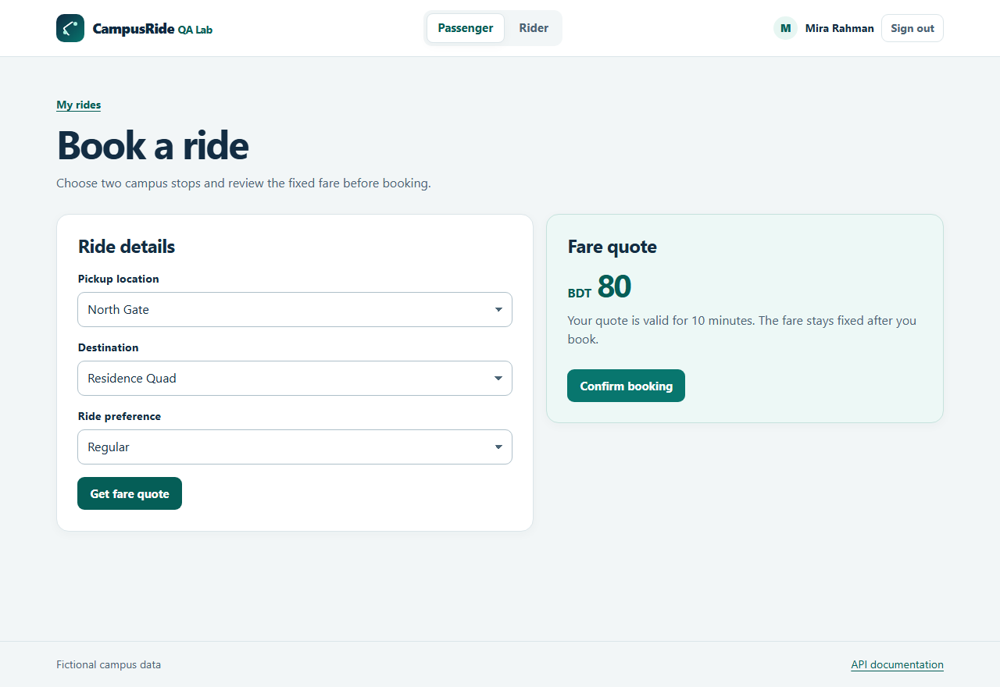
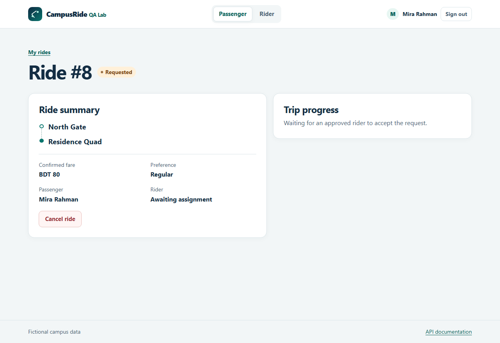

# CampusRide QA Lab

An independent software quality assurance portfolio for an SQA internship. CampusRide is a fictional student ride-sharing application. Its five campus stops, verification codes, accounts, and fares are simulated. The project follows a booking from the first fare quote to the moment both participants can see their ratings.

**[QA summary](reports/QA-Summary.md) · [Manual test cases](manual-testing/Test-Cases.xlsx) · [Execution evidence](#evidence-and-screenshots) · [Interview notes](docs/INTERVIEW-NOTES.md)**

## Test results

Local verification on Windows on 22 November 2026 used Python 3.11.5 and normal demo mode. Each row uses its runner's counting unit.

| Suite | Recorded outcome | Evidence |
| --- | --- | --- |
| Manual testing | 33 cases designed, 29 passed, 0 failed, 0 blocked, 4 not run in the recorded manual cycle | [Workbook](manual-testing/Test-Cases.xlsx) |
| Backend and REST API | 32 Pytest cases passed, 0 failed, 0 skipped | [Execution log](reports/execution/backend-pytest.txt) |
| Postman collection | 61 HTTP requests completed, 240 assertions passed, 0 failed | [Newman summary](reports/execution/newman-summary.txt) |
| Browser workflows | 18 Chromium cases passed, 0 failed, 0 skipped. Pytest reported one plugin deprecation warning. | [Execution log](reports/execution/ui-pytest.txt) |
| Controlled defect exercise | In the archived comparison, four regression checks failed with the defects active and the same four passed in normal mode. | [Defect-mode log](reports/bug-lab/03-defect-mode.txt) · [Normal-mode log](reports/bug-lab/04-corrected-mode.txt) |

## Project objectives and test design

The objectives are to turn business rules into repeatable checks, choose the right test level for each risk, and give a developer enough evidence to investigate a failure. All 16 documented requirements map to manual cases. Fifteen have at least one recorded manual pass. [Requirements](docs/REQUIREMENTS.md) · [Traceability matrix](manual-testing/Traceability-Matrix.xlsx)

| Feature under test | How it is tested |
| --- | --- |
| Registration, sign-in, sign-out and roles | Boundary values for student input, separate account sessions, and both permitted and denied actions |
| Rider applications, admin review and women-only eligibility | Compare approved, pending and unverified accounts, then check which requests each rider can see |
| Fare preview and booking | Check known fares, invalidate the preview after route changes, and exercise expired or previously used quotes |
| Assignment and cancellation | Send competing acceptances with two API clients, try an already-claimed request from a stale browser page, and check which trip states allow cancellation |
| Start, completion and ratings | Observe both participants after each confirmation and check score visibility before and after the second rating |

## Portfolio artifacts

| Area | What to inspect |
| --- | --- |
| Manual QA | [Test plan](manual-testing/Test-Plan.md), [cases and outcomes](manual-testing/Test-Cases.xlsx), [traceability](manual-testing/Traceability-Matrix.xlsx), [execution guide](manual-testing/Execution-Guide.md), [bug report template](manual-testing/Bug-Report-Template.md) |
| API testing | [API test plan](api-testing/API-Test-Plan.md), [request-level cases](api-testing/API-Test-Cases.md), [Postman collection](api-testing/CampusRide.postman_collection.json), [local environment](api-testing/CampusRide.local.postman_environment.json), [Pytest suite](tests/) |
| Browser automation | [Python page objects](automation/pages/), [18 scenarios](automation/tests/), [fixtures](automation/conftest.py), [run and debugging guide](automation/README.md) |
| Defect investigation | Four deliberately introduced local defects cover rider approval, fixed fares, rating visibility, and a synthetic phone field. [Investigation notes](docs/DEFECT-INVESTIGATION.md) · [Bug reports](bug-reports/) |
| Final review | [Coverage, gaps and recommendations](reports/QA-Summary.md) · [Interview questions and resume bullets](docs/INTERVIEW-NOTES.md) |

## Evidence and screenshots

This passenger selected North Gate and Residence Quad. The app displayed **BDT 80** before confirmation and carried the same fare onto the booked ride.

| Fare preview | Confirmed booking |
| --- | --- |
|  |  |

- **Application views** · [Login](reports/screenshots/login.png) · [Passenger](reports/screenshots/passenger-dashboard.png) · [Rider](reports/screenshots/rider-dashboard.png) · [Admin](reports/screenshots/admin-dashboard.png)
- **Successful browser run** · [Pytest output](reports/screenshots/automation-execution.png) · [Rendered HTML report](reports/screenshots/ui-test-report.png)
- **Controlled exercise** · The screenshot shows the four expected failures from the archived Phase 3 terminal output. [Screenshot](reports/screenshots/archived-defect-run.png) · [Source transcript](reports/bug-lab/03-defect-mode.txt)

The application captures use an isolated seed and real Chromium pages. The campus photograph on the login page is generated demo artwork.

## Technology

Python 3.11, FastAPI, SQLAlchemy and SQLite serve the application. Jinja2 templates, HTML, CSS and vanilla JavaScript provide the browser interface. The test tools are Pytest, FastAPI TestClient, Postman/Newman, Python Playwright, Chromium and pytest-html. GitHub Actions defines the continuous integration workflow.

## Run on Windows

From the repository root, use PowerShell and a Python 3.11 installation. The automation requirements include the backend and its test dependencies.

```powershell
python -m venv .venv
.\.venv\Scripts\python.exe -m pip install -r automation/requirements.txt
$env:DEMO_BUG_MODE = 'false'
$env:CAMPUSRIDE_SECURE_COOKIE = 'false'
$env:CAMPUSRIDE_DB_PATH = 'instance/campusride.db'
.\.venv\Scripts\python.exe -m app.demo
.\.venv\Scripts\python.exe -m uvicorn app.main:app --host 127.0.0.1 --port 8000 --no-proxy-headers
```

Open the [local app](http://127.0.0.1:8000/). Rerunning the seed on the same file preserves its records. For a fresh scenario, stop Uvicorn, choose a new database filename, and repeat the last two commands. The [manual execution guide](manual-testing/Execution-Guide.md#demo-accounts-and-rides) lists the seven starting rides.

| Fictional account | Starting role and test use |
| --- | --- |
| `mira@campus.example` | Passenger eligible to book women-only rides |
| `anika@campus.example` | Approved rider eligible for women-only requests |
| `tariq@campus.example` | Approved rider eligible for regular requests |
| `sami@campus.example` | Passenger with a pending rider application |
| `admin@campus.example` | Admin who reviews rider applications |

The local seed uses the shared demo password `CampusDemo2026!`. Use a separate browser profile for the second participant.

### Try the API

Sign in through the app and open [Swagger UI](http://127.0.0.1:8000/docs) on the same hostname. As a passenger, submit this body to `POST /api/rides/quote`.

```json
{"pickup": "north_gate", "destination": "residence_quad", "preference": "regular"}
```

Expect HTTP `201` and a fare of BDT 80. Send the returned `id` as `quote_id` to `POST /api/rides` to book. The Postman collection changes ride and account state, so start it against its own freshly seeded database. The [API execution guide](api-testing/README.md) includes the Postman import and Newman commands.

### Run the automated suites

In a PowerShell window at the repository root, run the backend/API and browser checks. Their fixtures start the required app instances and supply fresh SQLite copies.

```powershell
$env:DEMO_BUG_MODE = 'false'
.\.venv\Scripts\python.exe -m pytest tests -q -ra
$env:PLAYWRIGHT_BROWSERS_PATH = Join-Path (Get-Location) 'instance/playwright-browsers'
.\.venv\Scripts\python.exe -m playwright install chromium
.\.venv\Scripts\python.exe -m pytest -c automation/pytest.ini automation/tests -v
```

The browser run writes `automation/reports/ui-report.html`. Failed browser tests retain screenshots and traces. Add `--headed` for an interactive run.

## Continuous integration

Pushes and pull requests trigger three independent jobs on Ubuntu 24.04 with Python 3.11 and `DEMO_BUG_MODE=false`. The backend job runs Pytest. The Newman job seeds a fresh SQLite file, starts Uvicorn on loopback and runs the collection. The browser job installs Chromium and its system libraries, then runs Playwright. An assertion failure fails its job while the other jobs can finish.

Each job is configured to upload its JUnit report under **Artifacts**. The Chromium artifact also includes the HTML report and any failure screenshots and traces. Retention is 14 days. GitHub-hosted execution and artifact upload await the first hosted run of this workflow. [Workflow definition](.github/workflows/qa-tests.yml)

## Repository structure

```text
.github/workflows/   GitHub Actions workflow
app/                 API, business rules, demo seed, templates and static assets
tests/               Backend, API and regression checks
manual-testing/      Test plan, case workbook, traceability and execution guide
api-testing/         Postman collection, local environment and API test documentation
automation/          Python Playwright fixtures, page objects and tests
bug-reports/         Four controlled defect reports
reports/             QA summary, recorded runs and screenshots
docs/                Requirements, investigation and interview notes
```

## Known limitations and future improvements

Automated browser coverage uses Chromium. The small SQLite seed supports functional testing of fixed fares and mock verification. Payments, live GPS, third-party identity checks and production-scale traffic are outside the simulation.

Four manual cases remain open. They cover the browser fare preview, overlapping rider acceptances, cancellation by each assigned participant, and the responsive layout and Swagger walkthrough. Complete those cases with saved observations, then extend the browser checks to keyboard navigation and a second browser engine. [Open cases and recommendations](reports/QA-Summary.md#requirement-coverage-and-open-manual-cases)
