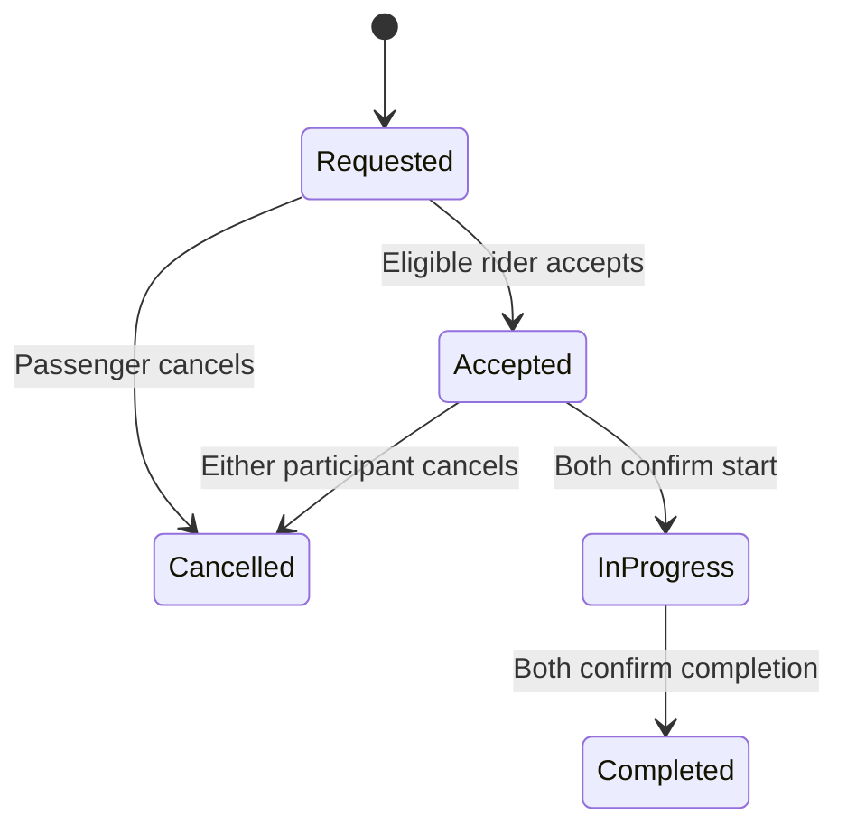

# CampusRide QA Lab

CampusRide QA Lab is an independent portfolio project for testing the business rules of a student ride-sharing app. Phase 1 runs locally with FastAPI, SQLAlchemy, SQLite, Jinja2, and plain JavaScript. The university, accounts, stops, and rides are fictional.

## Run on Windows

Open PowerShell in the project folder. Use Python 3.11 or newer.

```powershell
python --version
python -m venv .venv
.\.venv\Scripts\python.exe -m pip install -r requirements-dev.txt
Copy-Item .env.example .env
.\.venv\Scripts\python.exe -m app.demo
.\.venv\Scripts\python.exe -m uvicorn app.main:app --host 127.0.0.1 --port 8000 --reload
```

Open the [app](http://127.0.0.1:8000), [interactive API documentation](http://127.0.0.1:8000/docs), or [health endpoint](http://127.0.0.1:8000/health). Use the same hostname for the app and Swagger UI so they share the login cookie. The app and Swagger assets are served locally.

Use `requirements.txt` in the install command for a runtime-only environment. The default database is `instance/campusride.db`. Set `CAMPUSRIDE_DB_PATH` in `.env` to use a different file. The seed command creates the schema, then loads the same fictional accounts and ride scenarios on a fresh database. Rerunning it preserves the sandbox state you have already created.

## Demo accounts

Every demo account uses the password `CampusDemo2026!`. The sign-in page can fill the passenger, approved rider, and admin credentials for you.

| Account | Campus email | Access | Women-only eligibility |
| --- | --- | --- | --- |
| Mira Rahman | `mira@campus.example` | Passenger | Eligible |
| Anika Karim | `anika@campus.example` | Passenger and approved rider | Eligible |
| Tariq Hasan | `tariq@campus.example` | Passenger and approved rider | Off |
| Sami Chowdhury | `sami@campus.example` | Passenger with pending rider approval | Off |
| Nadia Ahmed | `admin@campus.example` | Admin | N/A |

Sign in as Mira and book a ride after reviewing its quote. Use a second browser profile or a private window for Anika. Accept the ride from Anika's Rider dashboard, then confirm the start and completion from both accounts. Refresh the other window after each action to see the new state. Submit a rating from each account to reveal the scores. Sign in as Nadia to review Sami's pending application. To test a new application, register a fictional student and enter a code such as `MOCK-CAMPUS01` on the Rider dashboard.

## Business rules

- A student account starts with passenger access. Admin approval adds rider access. The women-only flag is an explicit fictional profile setting chosen during registration or assigned in demo data.
- Fares are `40 + 10 × absolute difference between stop zones` BDT. The five stops are ordered North Gate, Main Library, Engineering Hall, Student Center, and Residence Quad. Each quote lasts 10 minutes and can create one ride at its original price.
- A passenger can cancel a requested ride. After acceptance, either participant can cancel before both start confirmations arrive.
- Only the trip participants can confirm or rate their ride. Each action is recorded once. An admin can view trip statuses and progress.



See the [requirements and acceptance criteria](docs/REQUIREMENTS.md) for the full list.

## Try the API

In Swagger UI, execute `POST /api/auth/login` with a demo email and password or sign in through the web app in the same browser. `GET /api/auth/me` shows the signed-in account and roles. To request a fare, execute `POST /api/rides/quote` with this body.

```json
{
  "pickup": "north_gate",
  "destination": "residence_quad",
  "preference": "regular"
}
```

Use the returned quote `id` as `quote_id` in `POST /api/rides`. The API uses `401` for missing sign-in, `403` for insufficient permissions, `404` for missing or inaccessible records, `409` for state conflicts, and `422` for invalid input.

## Run the backend tests

```powershell
.\.venv\Scripts\python.exe -m pytest -q
```

Pytest uses temporary SQLite copies of the demo data. The suite covers account validation, permissions, rider review, quote integrity, women-only access, concurrent acceptance and confirmations, cancellation, rating privacy, and basic HTML and API documentation responses.

## Project layout

```text
app/
  main.py           FastAPI setup and health check
  api.py            JSON routes
  web.py            Jinja2 pages
  domain.py         Stop, preference, and status definitions
  models.py         SQLAlchemy tables
  schemas.py        Pydantic request and response types
  services/         Account, ride, and admin rules
  demo.py           Repeatable local demo seeding
  templates/        Server-rendered HTML
  static/           CSS, browser JavaScript, and campus photo
docs/               Implemented requirements
tests/              Pytest integration tests
```

## Phase 1 scope

The lab uses fixed mock stops, mock verification codes, and simulated fares. It is designed for local use with JavaScript enabled. Users refresh to see actions taken in another browser session. The demo uses a local SQLite file and small, unpaginated lists. Manual QA artifacts, a Postman collection, Playwright, and CI/CD belong to later phases.

### Campus photo

The built-in image generation tool created [the original campus photo](app/static/campus.jpg) with this prompt.

> Make a premium editorial photograph for the left panel of a fictional campus ride-sharing web app, CampusRide QA Lab. Portrait 4:5 composition. A candid, realistic scene at a leafy contemporary fictional university campus in Bangladesh, with two college-age students with backpacks walking beside their bicycles on a campus lane, seen at mid-distance from behind. Blue-green glass and warm red brick academic buildings, tree canopy and subtle street markings, humid late-afternoon daylight. Keep the scene naturally lit in muted teal, navy, fern and warm brick, with the middle and upper area containing the subjects and campus and space at the bottom for a dark overlay and white UI copy. Authentic documentary campus photography, wide-angle eye-level from across the lane, clean framing, grounded texture, no typography, no logos, no brand marks, no watermark, no interface elements.
